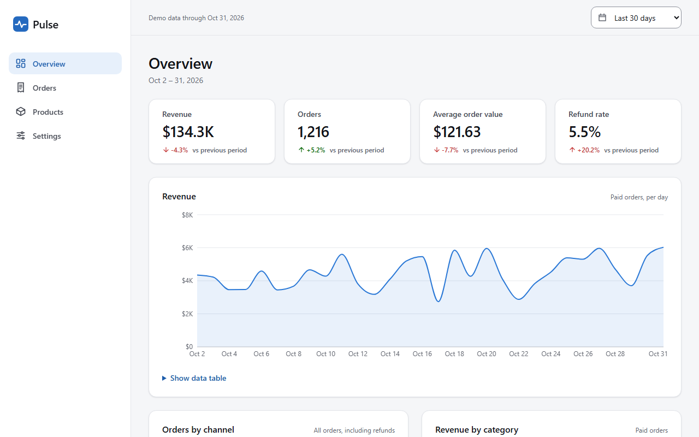

# Pulse — Analytics Dashboard

Pulse is a front-end only analytics dashboard for a fictional online store.
Every number on screen is computed in the browser from generated data:
there is no backend, no database, no API key and no environment variable.

**Live demo:** _the link is added after the first deployment._



> Demo project with generated data. The store, its products and its orders are not real.

## Features

- **Overview:** revenue, orders, average order value and refund rate, each with the % change
  against the previous period of the same length.
- **Charts:** revenue over time (per day, week or month), orders by channel, revenue by category (donut),
  and the top 5 products.
- **Orders:** search by order ID or product, filters for status, region and channel, sortable columns,
  20 rows per page and **Export CSV** of all filtered rows.
- **Products:** units sold, revenue and a trend sparkline for all 40 products, plus a details page
  for each product with its own charts and latest orders.
- **Settings:** currency (USD, EUR, EGP — display only, amounts are not converted) and a light/dark theme.
- **One global date range:** last 7, 30 or 90 days, last 12 months, or a custom range. It changes every screen.
- **Shareable URLs:** the date range, filters, sort order and page live in the query string,
  so a copied link opens the same view and the Back button works.
- **States:** loading skeletons (a short simulated first load), empty states, an error boundary and a 404 page.
- **Accessibility:** labels on every control, visible focus, full keyboard use, WCAG AA contrast in both themes,
  text summaries of every chart for screen readers, and a data table behind the revenue chart.
- **Responsive:** checked at 360, 768 and 1280 px. Below 1024 px the sidebar becomes a drawer.

## Tech stack

| Tool | Version | Used for |
| --- | --- | --- |
| [React](https://react.dev) | 19 | User interface |
| [Vite](https://vite.dev) | 8 | Dev server and production build |
| [React Router](https://reactrouter.com) | 8 | Pages and the URL query string |
| [Recharts](https://recharts.github.io) | 3 | Charts |
| [Vitest](https://vitest.dev) | 5 | Unit tests |
| ESLint | 10 | Code checks (same setup as the official Vite React template) |
| Plain CSS | — | Styles with CSS variables (design tokens) for both themes |

JavaScript only (no TypeScript). No other UI or state libraries.

## Run it locally

You need [Node.js](https://nodejs.org) 20.19+ or 22.12+ (required by Vite 8) and npm.

```bash
npm install
npm run dev        # start the dev server on http://localhost:5173
npm test           # run the unit tests once
npm run lint       # check the code with ESLint
npm run build      # build the production files into dist/
npm run preview    # serve the production build locally
```

## Folder structure

```
pulse-analytics-dashboard/
├── docs/                  PLAN.md, HOW_IT_WORKS.md and the README screenshot
├── public/                favicon.svg and og-image.png (copied as they are)
├── src/
│   ├── data/              catalog, seeded random generator, data generator (+ tests)
│   ├── lib/               pure functions: dates, ranges, metrics, format, CSV, table helpers (+ tests)
│   ├── settings/          currency and theme: storage, context, provider, hook
│   ├── hooks/             URL state, date range, order filters, drawer, focus, simulated loading
│   ├── components/
│   │   ├── layout/        app frame, sidebar, top bar, date range picker
│   │   ├── ui/            small reusable parts: icons, empty state, skeleton, pagination, ...
│   │   ├── kpi/           KPI cards
│   │   ├── charts/        chart card, tooltip, revenue / channel / category charts, sparkline
│   │   ├── orders/        filters, orders table, status badge
│   │   └── products/      products tables, trend label, product charts
│   ├── pages/             Overview, Orders, Products, Product details, Settings, 404
│   ├── styles/            design tokens and shared CSS
│   ├── test/fixtures.js   a tiny hand-made order list for tests
│   ├── App.jsx            routes
│   └── main.jsx           entry point
├── index.html             page title, description and Open Graph tags
├── vercel.json            sends every route to index.html (single page app)
└── vite.config.js
```

A file-by-file explanation is in [docs/HOW_IT_WORKS.md](docs/HOW_IT_WORKS.md).

## How the data works

`src/data/generate.js` creates 40 products and about 12,500 orders for the 12 months from
Nov 1, 2025 to Oct 31, 2026. It uses a **seeded** random generator (mulberry32), so the data is
exactly the same on every load. The app's "today" is fixed to Oct 31, 2026, the last day of the data,
so "Last 7 days" always shows orders. For "Last 12 months" there is no earlier year to compare with,
so the cards say "No earlier data to compare" instead of showing a made-up change.

Revenue counts only paid orders (completed and processing). The CSV export contains the raw amounts
without a currency symbol.

## Tests

`npm test` runs 76 Vitest tests: every function in `src/lib/metrics.js`, the CSV export
(including the download step), the date and range helpers, the table helpers, formatting,
chart summaries and the data generator.

## What I learned

- A **seeded random generator** makes demo data look random but stay the same on every load,
  and a fixed "today" keeps the demo useful in the future.
- Keeping the business logic in **pure functions** made the numbers easy to test and kept
  the React components small.
- Putting **filters in the URL** gives shareable links and a working Back button for free. The search
  box needed `replace` (no history entry per letter) and synchronous router updates so no letter is lost.
- **Accessibility** is mostly HTML done right: `fieldset`/`legend`, `aria-sort`, `role="status"`,
  a skip link, focus moved into and out of the mobile drawer, and an `inert` page behind it.
- Charts need a **text version**: a short summary for screen readers and a table anyone can open.
- **Code splitting** with `React.lazy` keeps the first download small, because only pages with charts
  need the chart library.
- **Dates as UTC strings** (`'2026-10-31'`) avoid time-zone bugs and are easy to compare and put in a URL.
- A safe **CSV export** quotes commas and quotes (RFC 4180) and guards against spreadsheet formula injection.

## Project documents

- [docs/PLAN.md](docs/PLAN.md) — the plan written before the build
- [docs/HOW_IT_WORKS.md](docs/HOW_IT_WORKS.md) — every file explained, the rebuild order and interview questions
